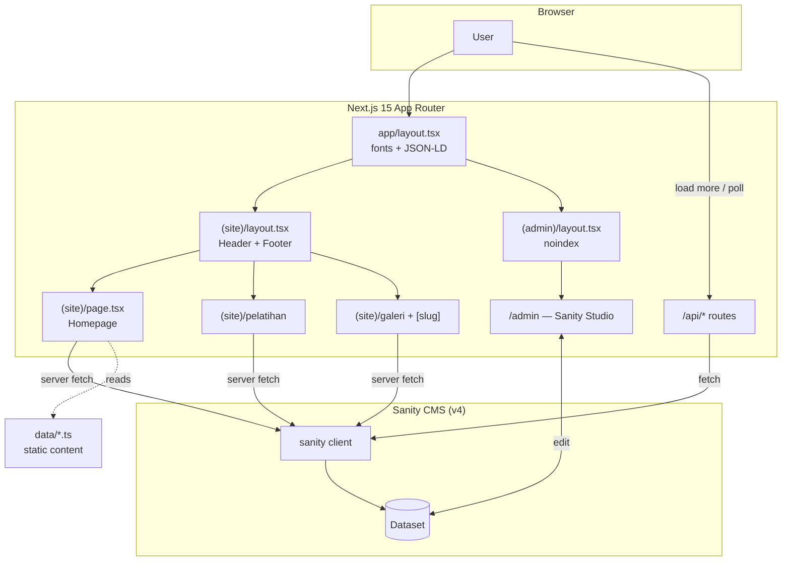
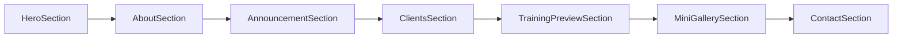

# Architecture

## Rendering Strategy

- **App Router** dengan dua route group:
  - `(site)` → website publik, punya `Header` + `Footer` layout.
  - `(admin)` → Sanity Studio, layout kosong + `robots: noindex`.
- **Server Components** default. Section yang butuh data Sanity adalah async server components yang fetch di server, lalu passing data ke child `*.client.tsx` untuk interaksi (carousel, slideshow, load-more).
- **ISR**: hampir semua fetch pakai `{ next: { revalidate: 60 } }` (revalidate tiap 60 detik).
- **API routes** (`/api/*`) dipakai untuk pagination client-side (load-more galeri) & polling announcement — bukan untuk render awal.
- Root `app/layout.tsx` set `lang="id"`, inject fonts (CSS vars) + JSON-LD base. `(site)/layout.tsx` menambah decorative blur background + Header/Footer.

## Data Sources

Ada dua sumber konten:

1. **Sanity CMS** (dinamis, editable): gallery album, training package, site settings (hero stats), announcement.
2. **Static data** di `data/*.ts` (hardcoded di kode): about, clients, contact info.

## Diagram — High Level



## Homepage Composition

`(site)/page.tsx` merangkai section berurutan:



| Section | Server/Client | Sumber data |
|---|---|---|
| HeroSection | server → client | **Slideshow: image STATIS** dari `public/images/hero/hero-1..8.JPG` (diacak per kunjungan). Stats: Sanity `siteSettingsQuery`. Kode fetch galeri (`heroSlideshowAlbumsQuery` + `pickHeroSlideshowImages`) di-comment, belum dihapus — bisa di-restore |
| AboutSection | static | `data/about.data.ts` |
| AnnouncementSection | client (polls API) | `/api/announcements?limit=6` |
| ClientsSection | static | `data/clients.data.ts` |
| TrainingPreviewSection | server | Sanity: `trainingPackagesPreviewQuery` (fallback hardcoded) |
| MiniGallerySection | server | Sanity: `miniGalleryAlbumsQuery` |
| ContactSection | static + WA link builder | `data/contact.data.ts` + `lib/contact-templates.ts` |

## Server → Client Pattern

Contoh (`hero-section.tsx`):

```
hero-section.tsx (server, async)
  ├── fetch heroSlideshowAlbumsQuery
  ├── fetch siteSettingsQuery
  └── <HeroSectionClient albums={...} stats={...} />   ← 'use client'
```

Pattern yang sama dipakai: `announcement-section` → `.client`, `gallery-album-grid` → `.client`, `gallery-album` → `.client`.

## Image Handling

- Sanity images → `sanity/lib/image.ts` `urlFor()` (image URL builder).
- Helper aman: `lib/utils.ts` `safeImageUrl(image, w, h)` → return `null` kalau asset invalid (nggak throw).
- `next.config.ts` allow remote images dari `cdn.sanity.io` dan `images.unsplash.com` (dummy).

## Known TODO / Rough Edges

- `sanity/env.ts` masih ada `console.log('DATASET', ...)` — debug leftover.
- `lib/environment.ts` punya komentar TODO soal setup Sanity dan `sanity` field opsional.
- `sanity/lib/live.ts` (`sanityFetch`/`SanityLive`) tersedia tapi **belum dipakai** — fetching masih manual via `client.fetch`.
- `TrainingPackage.slug` dikomentari di types — detail page per-training belum ada (baru list `/pelatihan`).
